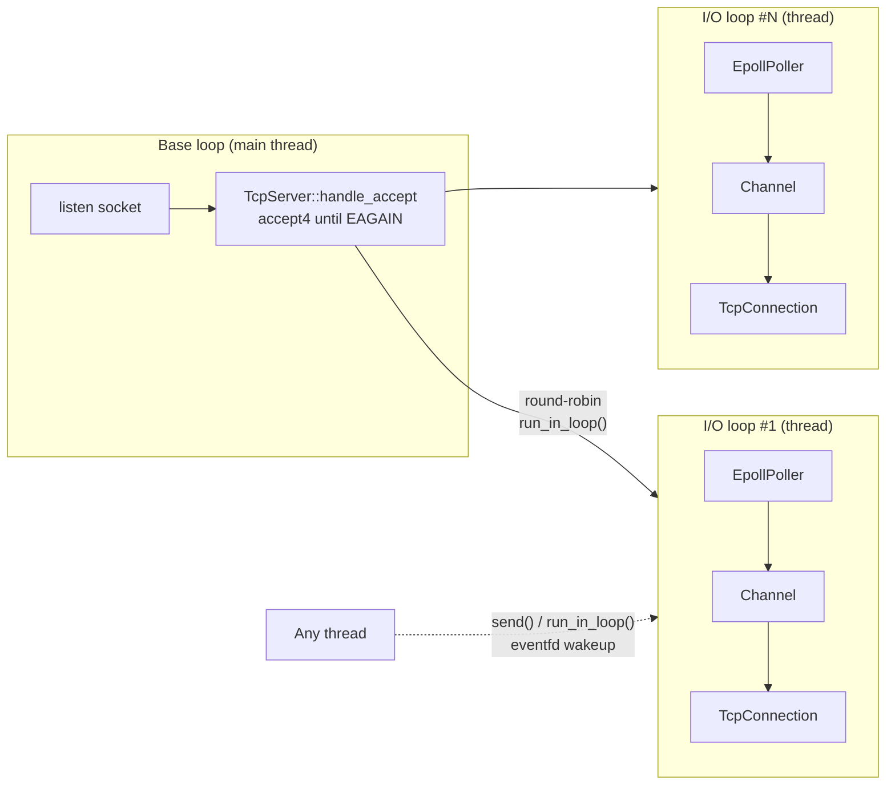

# tinynet — a multi-threaded Reactor network library in C++17

`tinynet` is a from-scratch, non-blocking TCP networking library for Linux, built on
`epoll` using the **one-loop-per-thread** Reactor pattern (the same architecture as
[muduo](https://github.com/chenshuo/muduo) and the core of servers like Nginx and Redis).
It has no dependencies beyond the C++ standard library and pthreads.

- **~158K echo round-trips/s and ~140K HTTP req/s on a single core**; 10,000 concurrent connections;
  **~674K HTTP req/s with 8 I/O threads**
- Main/sub Reactor: one acceptor loop + N I/O loops with round-robin connection assignment
- `eventfd` cross-thread wakeup, `timerfd`-based timer queue, `readv`-based I/O buffer
- Safe connection lifetime via `shared_ptr` + `weak_ptr` tie, no locks on the per-connection hot path
- Unit + end-to-end tests, clean under **AddressSanitizer** and **ThreadSanitizer**
  (TSan found two real concurrency bugs during development — see [below](#bugs-found-with-threadsanitizer))

## Architecture



Each `EventLoop` runs:

```text
while (!quit) {
    poller->poll()                 // epoll_wait: socket I/O, timerfd, eventfd
    for each active channel: channel->handle_event()
    do_pending_functors()          // work queued by other threads
}
```

| Component | Responsibility |
|---|---|
| `Socket` | RAII owner of a fd: move-only, `SOCK_NONBLOCK \| SOCK_CLOEXEC`, `accept4` |
| `InetAddress` | IPv4 `sockaddr_in` value type |
| `Buffer` | Byte buffer with prependable / readable / writable regions; `readv` + 64 KB stack spill |
| `Channel` | A fd + interested events + callbacks; never owns the fd |
| `Poller` / `EpollPoller` | Abstract I/O multiplexer and its `epoll` (level-triggered) implementation |
| `EventLoop` | The Reactor; cross-thread task queue woken by `eventfd` |
| `TimerQueue` | Ordered timers on one `timerfd`, so timers flow through the same epoll path as I/O |
| `EventLoopThread(Pool)` | Spawns I/O loops; round-robin connection assignment |
| `TcpConnection` | Per-connection state machine, input/output buffers, thread-safe `send` / `shutdown` |
| `TcpServer` | Acceptor + connection map + thread pool |

## Build and test

Linux only (uses `epoll`, `eventfd`, `timerfd`); on Windows use WSL.

```bash
cmake -S . -B build -DCMAKE_BUILD_TYPE=Release
cmake --build build -j
ctest --test-dir build --output-on-failure

# Sanitizer builds
cmake -S . -B build-tsan -DCMAKE_BUILD_TYPE=Debug -DTINYNET_SANITIZER=thread
cmake --build build-tsan -j && ctest --test-dir build-tsan
```

Run the examples:

```bash
./build/examples/echo_server 8888 4     # port, I/O threads
./build/examples/http_server 8080 4
curl http://127.0.0.1:8080/              # Hello, World!
```

## Usage

```cpp
#include "tinynet/EventLoop.h"
#include "tinynet/TcpServer.h"
using namespace tinynet;

int main() {
    EventLoop loop;
    TcpServer server(&loop, InetAddress(8888), "echo");
    server.set_thread_num(4);
    server.set_message_callback([](const TcpConnectionPtr& conn, Buffer* buf) {
        conn->send(buf);  // echo back
    });
    server.start();
    loop.loop();
}
```

## Performance

Measured on WSL2 (Hyper-V) with 16 logical CPUs, `-O3` Release build, 10-second runs.

**Single core** (server pinned to CPU 0, load generator pinned to CPU 1 with `taskset`):

| Workload | Connections | Throughput | Latency |
|---|---:|---:|---:|
| Echo ping-pong, 64 B (`echo_bench`) | 100 | **158K round-trips/s** | p50 0.59 ms, p99 1.3 ms |
| Echo ping-pong, 64 B (`echo_bench`) | 10,000 | 108K round-trips/s | p50 95 ms, p99 130 ms |
| HTTP/1.1 keep-alive (`wrk -t1 -c100`) | 100 | **140K req/s** | avg 0.39 ms |

Latency grows with connection count as Little's law predicts (10,000 in flight ÷ 108K/s ≈ 93 ms,
measured p50 95 ms); throughput stays high.

**Scaling with I/O threads** (server on CPUs 0–8, `wrk -t7 -c400 -d10s` on CPUs 9–15):

| I/O threads | HTTP req/s | Avg latency |
|---:|---:|---:|
| 1 | 36K | 11.0 ms |
| 2 | 123K | 3.2 ms |
| 4 | 327K | 1.2 ms |
| 8 | **674K** | 0.43 ms |

The 1- and 2-thread rows are depressed by a benchmark effect explained below, so this table is
not a clean speed-up curve; the 8-thread figure is the meaningful one.

Reproduce with `benchmarks/wrk_benchmark.sh` (uses the bundled `echo_bench` client and
[wrk](https://github.com/wg/wrk)). `echo_bench` is a separate raw-epoll client, so the library
is not benchmarked with itself.

### Investigating the 1-thread anomaly

With one I/O thread the server did 140K req/s under `wrk -t1 -c100` but only 36K under
`wrk -t7 -c400`. I changed one variable at a time:

| Experiment | Result | Conclusion |
|---|---:|---|
| Server pinned to a single CPU, `wrk -t7 -c400` | 42K | not caused by CPU migration |
| Server on CPUs 0–8, `wrk -t1 -c100` | 137K | the load shape matters |
| Original setup run twice in a row | 47K, 41K | not a warm-up effect |

Splitting the load shape (server pinned to CPU 0) and counting the server's voluntary context
switches over each 10 s run:

| wrk | req/s | Voluntary context switches | Per request |
|---|---:|---:|---:|
| `-t1 -c100` | 136K | 32,188 | 0.024 |
| `-t1 -c400` | 136K | 15,782 | 0.012 |
| `-t7 -c100` | 52K | 721 | 0.0001 |
| `-t7 -c400` | 53K | 594 | 0.0001 |

The slowdown depends only on the number of **client threads**, not on the number of connections.
My first hypothesis was that scattered requests made the server sleep and wake once per request;
the data rules that out: in the slow case the server almost never sleeps and is 100% busy.

Reading the server's CPU time from `/proc/<pid>/stat`:

| wrk | req/s | User time per request | Kernel time per request |
|---|---:|---:|---:|
| `-t1 -c100` | 143K | ~0.5 µs | ~5.9 µs |
| `-t7 -c100` | 47K | ~1.1 µs | **~20 µs** |

Over 90% of the server's time is in the kernel in both cases, and the extra cost per request is
almost entirely kernel time, not tinynet code. My working explanation: over loopback, the
sender's `send()` runs the receiver's TCP receive path on the sender's CPU and wakes the receiving
thread. With one busy wrk thread there is rarely anyone to wake; with seven mostly-idle wrk
threads, nearly every response must wake a sleeping thread on another CPU, and cross-CPU wakeups
are expensive inside a Hyper-V guest. I could not confirm this directly: the `RES`
(rescheduling IPI) counter in `/proc/interrupts` barely moved, most likely because Hyper-V
delivers these interrupts through its own mechanism, and `perf` is not available in WSL2.

Takeaways: single-thread results should be read with `wrk -t1`, and the multi-thread numbers above
are conservative, since every I/O thread also pays this client-side wakeup cost.

## Design notes

**Level-triggered epoll.** LT keeps notifying while a fd is ready, so a partial read can never
strand data, which keeps the code simple. The usual LT cost (extra `epoll_wait` calls) is offset by
`Buffer::read_fd`, which uses `readv` into the buffer plus a 64 KB stack array to drain a lot of data
in one syscall without pre-allocating large per-connection buffers. `EPOLLOUT` is enabled only while
the output buffer is non-empty; otherwise LT would busy-loop on an always-writable socket.

**Write path.** `send()` first writes directly to the socket when nothing is queued (the common case
needs no epoll round-trip). Leftover bytes from a partial write go to the output buffer and are
flushed by `handle_write` on `EPOLLOUT`. `MSG_NOSIGNAL` turns a write to a closed peer into `EPIPE`
instead of a process-killing `SIGPIPE`. A high-water-mark callback lets applications apply backpressure.

**Threading model.** A connection is bound to one I/O loop for its whole life, so its state is only
touched by one thread and needs no lock. Other threads hand work over with `run_in_loop()`; the
loop's task queue is guarded by a mutex held only for a `swap`, and an `eventfd` wakes a loop blocked
in `epoll_wait`. `queue_in_loop()` also wakes the loop when called *from* a pending functor, otherwise
the new task would wait for the next poll timeout.

**Connection lifetime.** A peer can disconnect while a user callback is still running, and another
thread may hold the connection to `send()`. `TcpConnection` is therefore owned by `shared_ptr`:
`TcpServer`'s map holds one reference, and the `Channel` holds a `weak_ptr` (`tie`) that is promoted
to a `shared_ptr` for the duration of each event dispatch. Removal from the server is done in the base
loop, and the final `Channel::remove()` is deferred with `queue_in_loop()` so it never happens while
that channel's `handle_event` is still on the stack.

**Graceful close.** `shutdown()` only sends FIN (`SHUT_WR`) after the output buffer drains;
`read() == 0` from the peer triggers close. A guard makes close idempotent when `EPOLLHUP` and
`EPOLLRDHUP` arrive in the same event batch.

**Running out of file descriptors.** On `EMFILE`, the pending connection would stay in the backlog
and the LT listen socket would spin. `TcpServer` keeps a spare fd open on `/dev/null`; it frees it,
accepts and immediately closes the connection, and re-opens the spare.

**Timers.** All timers share one `timerfd`, armed for the earliest deadline, so timers are just
another readable fd. Timers are identified by `(pointer, sequence)` because a freed timer's address
can be reused; a repeating timer can safely cancel itself from inside its own callback.

## Bugs found with ThreadSanitizer

1. **Use-after-free in `TimerQueue::add_timer`.** The function handed the new timer to the loop
   thread and *then* read `timer->sequence()` to build the returned id. A short one-shot timer could
   fire and be deleted in between. Fix: build the `TimerId` before handing the timer over.
2. **Lost `quit()` in `EventLoop::loop()`.** `loop()` reset `quit_ = false` on entry. If
   `EventLoopThread`'s destructor called `quit()` before the worker thread entered `loop()`, the quit
   was erased and `join()` hung forever (seen as a test timeout under parallel `ctest`). Fix: reset
   the flag on *exit* instead; a regression test starts and destroys 200 loop threads back to back.

## Project layout

```text
include/tinynet/   public headers
src/               implementation
tests/             unit + end-to-end tests (dependency-free test harness, run by ctest)
examples/          echo_server, http_server (keep-alive + pipelining)
benchmarks/        echo_bench (raw-epoll load generator), wrk_benchmark.sh
temp/echo_raw.cpp  the original blocking single-client echo server this project grew from
```
